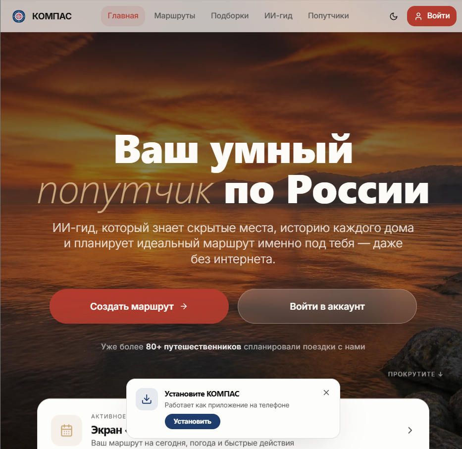
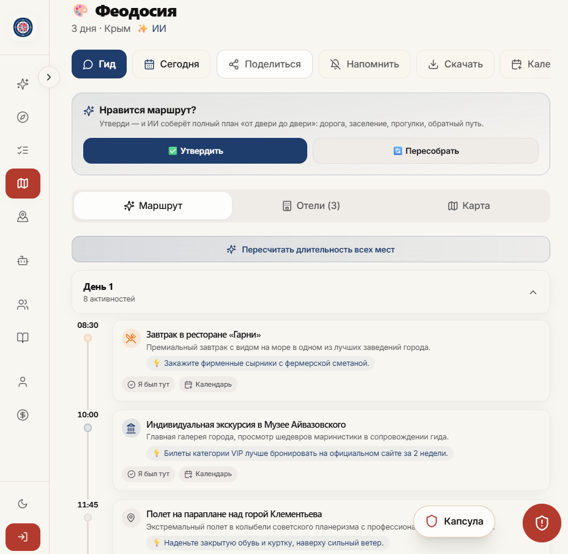
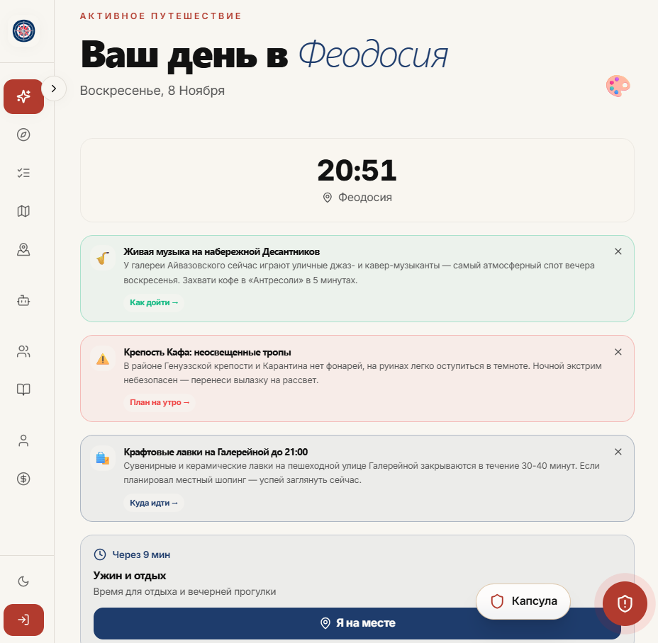
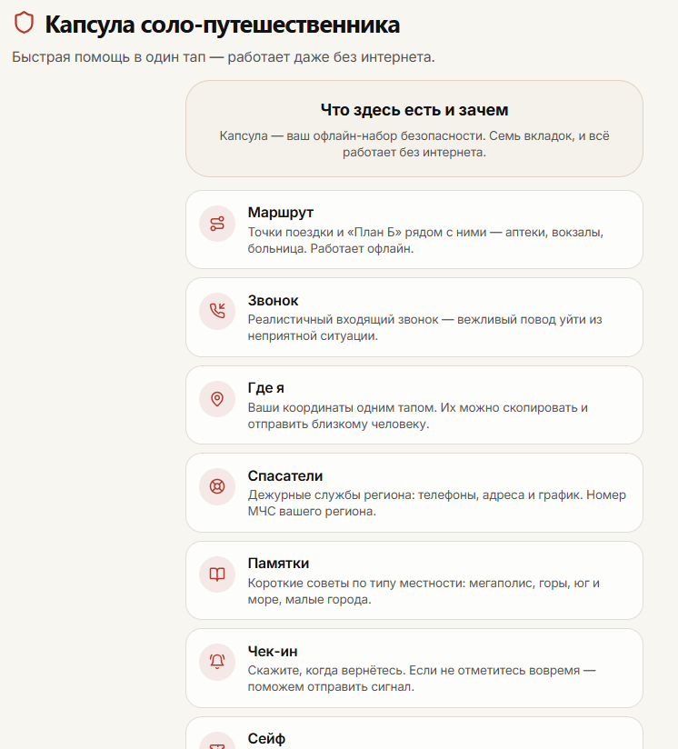
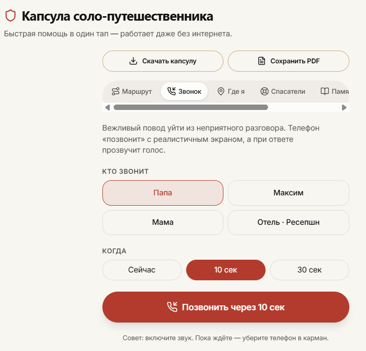

# Kompas (TripMind AI)
### AI travel planner and offline safety capsule for solo travelers in Russia

Live demo: https://travel-buddy-rus.lovable.app

## The problem
Solo travel in Russia comes with practical and psychological risks: no mobile coverage in mountains, nature reserves and between towns; tourists juggling 5–7 separate apps; GPS spoofing in large cities; early closing of pharmacies and transport in small towns; local etiquette in some regions.

## The idea
Kompas combines an AI itinerary builder with an offline safety capsule: the key information for a trip (route, tickets, Plan B, local rescue contacts, check-in timer) stays available without internet.

## Key features
- AI route builder: multi-day itineraries based on pace, budget and interests, generated in the cloud via Edge Functions. Input is through chips and sliders, no typing required.
- Offline safety capsule (7 modules): route, fake incoming call, SOS with GPS coordinates and ready-to-send SMS, rescue teams database (12 regions), Plan B guides, Plan B radar for nearby pharmacies, clinics and stations, check-in timer, encrypted ticket safe.
- Fake call simulator: configurable delay, realistic call screen, ringtone, vibration and voice (Web Audio, Web Speech and Vibration APIs).
- "Today" screen: timeline of the current day, "I'm here" button, contextual AI tips.
- AI guide chat: streaming answers with voice output.
- Interactive map (Leaflet) and a standalone HTML/PDF export of the capsule that works without installation.
- Companions: matching travelers with similar routes, with real-time chat.
- Gamification: tourist level, visited regions and achievements.

## Screenshots
| Route builder | "Today" screen | Safety capsule | Fake call |
|---|---|---|---|
|  |  |  |  |

## Tech stack
React 18 · TypeScript · Vite · Tailwind CSS · Radix UI / shadcn/ui · Leaflet · Supabase (PostgreSQL with Row Level Security, Auth, Realtime, Edge Functions on Deno) · IndexedDB · Service Worker / PWA · OpenStreetMap Overpass API.
Developed with the Lovable platform as an AI-assisted development tool.

## Status
- Implemented: landing page, route builder, "Today" screen, safety capsule with all modules, call simulator, rescue teams database, HTML/PDF export, local encrypted storage, 12-city catalog, authentication, PWA.
- Planned: payment gateway for subscriptions, live transport timetable sync, new regions (Altai, Kamchatka, Dagestan).
- Known limitations: the check-in timer in a mobile browser can be unloaded by the OS (native push or an SMS gateway is planned); rescue team contacts are collected from open sources and need periodic verification.

> Kompas is a planning and awareness tool. It does not replace emergency services (112).

## Research components
The research components of the project — semantic compression of geospatial data for LLM agents and dynamic route re-planning (MDP with an LLM as reward function) — are part of the proprietary core of the prototype and are not included in this repository. They are described in peer-reviewed publications (see my ORCID profile below), and further details are available to interested investors and collaborators.

## Author
Marina Gorina · AI/ML engineer
ORCID: https://orcid.org/0009-0002-9801-1834 · GitHub: https://github.com/colliiiis

*This repository contains documentation only. No open-source license is granted for reuse.*
